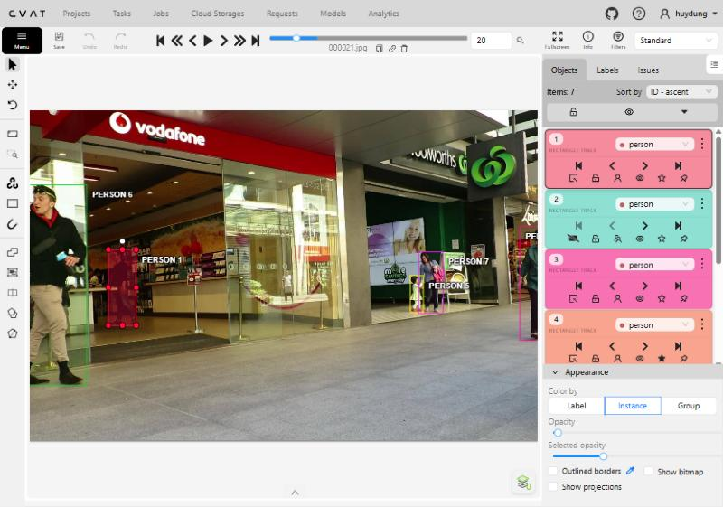
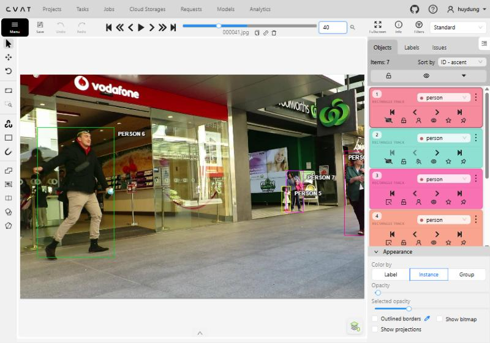
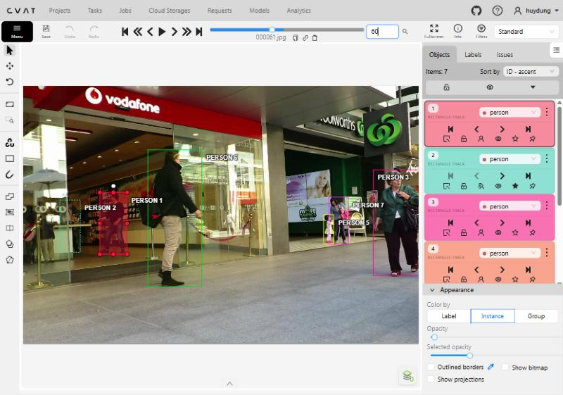

# Báo cáo cá nhân — HaHuyDung-2A202603271

Đoạn video: MOT17-09, 150 frame (frame 1–150), nguồn MOTChallenge, giấy phép CC BY-NC-SA 3.0.
Ảnh chụp màn hình: "MOT17, MOTChallenge (Milan et al., 2016)".

> Số frame trong báo cáo ghi **theo CVAT (0–149)**. Trong `gt.txt`, `frame_id` = frame CVAT + 1.

## 0. Thông tin học viên

- Họ tên: Ha Huy Dung
- MSSV: 2A202603271
- Mã đề (A/B/C): **A** — task `DAY05-MOT17-09-A-2A202603271` (Task #13, Job #13 trên CVAT local)
- Email: hahuyd25@gmail.com
- Link repository: https://github.com/hdung25/K5-L2-HaHuyDung-2A202603271-MOTTracking
- Giờ bắt đầu: 16:15
- Giờ kết thúc: 17:36

Năm người của đề A (MOT ID gốc theo `src/lab_variants.json`) và track ID trong file nộp:

| Mã | MOT ID gốc | Mô tả nhận diện | Track ID trong `annotations.xml` | Track ID trong `gt.txt` |
|---|---:|---|---:|---:|
| P1 | 1 | Nam áo len đen, quần jean, trong shop Vodafone | 0 | 1 |
| P2 | 7 | Nữ áo trắng/cam, quần đen, trong shop Vodafone (đi vào từ sau khung cửa kính) | 1 | 7 |
| P3 | 19 | Bà áo khoác xanh lá, túi đen, đi về phía camera | 2 | 2 |
| P4 | 20 | Ông áo xanh dương, mũ trắng, đi cạnh P3 | 3 | 3 |
| P5 | 21 | Bé gái váy trắng hoa xanh, giày đỏ, trước cửa Woolworths | 4 | 4 |
| P6 | — (thêm) | Nam áo khoác đen, quần kaki, đeo balo, đi ngang sát camera | 5 | 5 |
| P7 | — (thêm) | Nữ áo khoác xám, quần jean, cầm túi hồng — mẹ của bé gái P5 | 6 | 6 |

CVAT đánh số `track_id` trong MOT 1.1 theo thứ tự frame xuất hiện đầu tiên nên khác thứ tự P1–P7; bảng trên là ánh xạ để đối chiếu.

> **Ghi chú về P6, P7 (ngoài 5 người của đề):** mình gán thêm hai người rõ ràng, có mặt lâu trong đoạn video: người đeo balo che P1 ở CP2 và mẹ của P5. Họ được gán đúng quy ước như 5 người chính (track mode, `occluded` / `outside`, cùng ID qua đoạn che). Vì vậy file nộp có **7 track**. Script tự kiểm được chạy với `--expected 7`; nếu chấm theo 5 người của đề A thì chỉ cần lọc track 5 và 6 trong `gt.txt` (track 5 và 6 trong `annotations.xml`).

## 1. Xem trước đoạn video (CP0)

Ghi **trước khi vẽ**, mỗi người một dòng (xem hết 150 frame với `Player step = 10`, đối chiếu bảng nhận diện `de-A-P1-P5.jpg`).

| Mã | Frame xuất hiện | Frame cuối thấy được | Rẽ / dừng / đổi tốc độ ở frame | Bị che ở frame | Ghi chú |
|---|---|---|---|---|---|
| P1 | 0 | 149 | 0–30 đi chậm sang phải trong shop; ~57–100 đi tiếp sang phải và bắt đầu lại gần; ~100 rẽ hướng thẳng về camera, box to dần đến 149 | 26–56 (người áo khoác đen đeo balo đi ngang trước camera; mất hẳn ~34–46) | Người mục tiêu CP2. Sau kính, ánh phản chiếu nhiều |
| P2 | 60 | 149 | 60–100 đi sang phải (tâm x ~250 → 373); ~105 rẽ về phía camera, box to dần | 60–66 (nửa trái khuất sau khung cửa kính) | Frame 39–59 ở đúng vị trí đó là **ông đứng quầy** — không phải P2, dễ đổi ID |
| P3 | 0 | 149 | Đi chéo về phía camera suốt đoạn; tăng tốc theo phương ngang sau ~80; kích thước tăng mạnh (cao ~340 → ~780 px) | không bị che đáng kể | Đi sát P4 từ ~30 đến 149 |
| P4 | 0 | 149 | 0–35 đi vào từ mép phải (chỉ thấy tay/vai rồi nửa người); từ ~100 đi sang trái nhanh hơn, lại gần camera | không (chỉ bị mép ảnh cắt ở 0–35) | Cuối đoạn chân xuống tới y ≈ 1060, dễ vẽ hụt chân |
| P5 | 0 | 147 | 0–35 đi sang phải vài bước rồi **đứng yên** 35–147 | 106–109 (tay/thân P3), mất hẳn 110–134 (P3 đi qua); 145–147 (chân P4), mất hẳn 148–149 | Bé nhỏ (cao ~123 px) |
| P6 | 0 | 133 | 0–20 đi vào từ mép trái; 20–113 đi ngang sang phải và ra xa camera (box nhỏ dần, cao ~560 → ~400 px) | 112–119 (đi sau P3), mất hẳn 120–125; hiện lại ở khe P3–P4 126–133; mất sau P4 từ 134 | Chính là người che P1 ở frame 26–56 |
| P7 | 0 | 104 | Đứng gần như yên cạnh P5 suốt đoạn thấy được (dịch ~50 px sang phải ở 0–40) | 92–104 (P3 đi ngang phía trước), mất hẳn từ 105 | Sau 105 bị P3 rồi P4 che hết, không hiện lại |

## 2. Keyframe và thời gian (CP1, CP4)

Số keyframe lấy từ kết quả `src/check_submission.py` (mục 5).

| Mã | Số keyframe | Keyframe ở frame | Số frame có mặt | Keyframe / 100 frame | Thời gian (phút) | Chỗ khó |
|---|---|---|---|---|---|---|
| P1 | 16 | 0, 8, 13, 18, 26, 33, 47, 57, 68, 75, 83, 88, 95, 102, 133, 149 | 137 (outside 34–46) | 11,7 | — | Đoạn che 26–56: box amodal xuyên qua người đi ngang và balo |
| P2 | 9 | 60, 63, 67, 73, 81, 90, 111, 137, 149 | 90 | 10,0 | — | Phân biệt với ông đứng quầy ở cùng chỗ (39–59); khung cửa che nửa trái 60–66 |
| P3 | 12 | 0, 43, 50, 63, 75, 82, 103, 114, 125, 135, 143, 149 | 150 | 8,0 | — | Kích thước tăng nhanh khi lại gần camera |
| P4 | 9 | 0, 20, 35, 54, 68, 90, 124, 129, 149 | 150 | 6,0 | — | Bị mép ảnh cắt 0–35; đáy box phải chạm bàn chân cuối đoạn |
| P5 | 10 | 0, 6, 22, 38, 106, 109, 135, 138, 145, 147 | 123 (outside 110–134, 148–149) | 8,1 | — | Hai lần bị che bởi P3 / P4 |
| P6 | 22 | 0, 6, 20, 36, 46, 53, 56, 59, 62, 67, 73, 80, 86, 92, 99, 104, 112, 116, 119, 126, 128, 133 | 128 (outside 120–125, 134–149) | 17,2 | — | Đi nhanh, dáng bước và balo làm box đổi rộng liên tục; đoạn khuất sau P3 |
| P7 | 5 | 0, 17, 36, 92, 104 | 105 (outside 105–149) | 4,8 | — | Đứng yên nên ít keyframe; bị P3 che dần |
| **Tổng** | **83** | | **883** | | **~81 (cả bài)** | |

Thời gian: không bấm giờ riêng từng người vì box gợi ý được tạo bán tự động rồi soát chung; tổng thời gian làm bài ghi ở dòng Tổng (từ giờ bắt đầu đến giờ kết thúc ở mục 0).

Keyframe / 100 frame của cả bài = tổng keyframe ÷ tổng số frame có mặt × 100 = 83 ÷ 883 × 100 ≈ **9,4** (riêng 5 người của đề: 56 ÷ 650 × 100 ≈ 8,6)

Cách chọn keyframe: với mỗi khoảng giữa hai keyframe, so box nội suy tuyến tính `b(t) = b(k0) + u·(b(k1) − b(k0))` với box thật từng frame; nếu ở frame nào IoU < 0,85 (chặt hơn ngưỡng trôi 0,7 của lớp) thì thêm keyframe tại frame lệch nhiều nhất rồi kiểm lại. Ngoài ra luôn đặt keyframe ở frame đầu/cuối, ngay trước khi mất hẳn, khi hiện lại và tại mỗi frame bật/tắt cờ `occluded`. Kết quả: mọi frame nội suy có IoU ≥ 0,85 so với box thật (trung bình 0,94–0,96 mỗi người).

Bạn đặt keyframe nhiều nhất ở người nào? Vì sao (người đó rẽ, dừng, lại gần camera hay bị che)?

Nhiều nhất là **P6 (22 keyframe)**: người này đi nhanh nhất cảnh, sải chân rộng và vung balo nên chiều rộng box đổi theo từng bước, lại đi ra xa camera (box nhỏ dần) và bị P3 che ở cuối. Trong 5 người của đề, nhiều nhất là **P1 (16 keyframe).** P1 vừa bị che dài (26–56, mất hẳn 34–46) vừa đổi hướng hai lần: đi ngang trong shop rồi rẽ thẳng về camera quanh frame 100, nên box vừa đổi vị trí vừa to dần. Phải có keyframe ở 26 (bắt đầu `occluded`), 33 (ngay trước khi mất), 47 (hiện lại) và 57 (thấy rõ, tắt `occluded`), cộng thêm keyframe dày 68–102 ở khúc rẽ. Ngược lại P4 chỉ cần 9 keyframe: đi gần như thẳng đều, chỉ đổi tỉ lệ kích thước.

## 3. Đoạn bị che (CP2)

Người bị che: `P1` (bị người áo khoác đen đeo balo đi ngang sát camera che)

| Mốc | Frame |
|---|---:|
| Bắt đầu bị che một phần (bật `occluded`) | 26 |
| Mất hẳn (bật `outside`) | 34 |
| Hiện lại (tắt `outside`) | 47 |
| Thấy rõ trở lại (tắt `occluded`) | 57 |

- Thời gian khuất hẳn: **13** frame (34–46) = **0,43** giây (13/30).
- Quyết định: **giữ cùng ID**.
- Lý do (trả lời 3 câu: khuất bao lâu so với 60 frame, ngoại hình có khớp, chỗ hiện lại có đúng hướng và tốc độ):

1. Khuất hẳn 13 frame, rất nhỏ so với ngưỡng 60 frame (2 giây) của lớp → đủ điều kiện giữ cùng track.
2. Ngoại hình khớp: áo len đen cổ tim, quần jean xanh, giày tối màu, đeo kính, cùng chiều cao box (~250 px) trước và sau khi che.
3. Hiện lại đúng hướng và tốc độ cũ: trước khi che P1 đi sang phải ~1,2 px/frame (tâm x 305 → 366 ở frame 0–30); khi hiện lại ở frame 47 tâm x ≈ 395, đúng chỗ ngoại suy từ quỹ đạo cũ → tắt `outside` ở 47, đặt keyframe mới, không tạo track mới.

Cách vẽ box trong đoạn che: box là **amodal** (toàn thân ước lượng), không co theo phần còn thấy. Giữa frame 26 và 56 detector chỉ thấy chân P1 qua khe giữa hai chân người đi ngang, rồi lại gộp cả balo của người đó vào box (rộng tới x = 484), nên box ở đoạn này được nội suy tuyến tính giữa box rõ ở frame 25 và 57 và đối chiếu với vị trí chân lộ ra. Mốc `outside` 34–46 là đoạn thân trên và đầu P1 nằm hoàn toàn sau người đi ngang; box P1 bị box người đó phủ 100% (cách MOT17 tính cột `visibility`).

Ảnh chụp màn hình:





Chú thích ảnh (CVAT local, job #13, nhãn trên canvas là `PERSON <ID>`; P1 = object ID 1):
- `che_1_truoc.png` — frame 20: P1 (PERSON 1) đứng trong shop, người đeo balo (PERSON 6) đang đi tới từ bên trái.
- `che_2_giua.png` — frame 40: P1 mất hẳn sau PERSON 6, canvas không còn box P1 nhưng object 1 vẫn nằm trong panel Objects với cờ `outside` bật.
- `che_3_sau.png` — frame 60: P1 hiện lại, vẫn là PERSON 1 (cùng object ID 1); bên trái là P2 (PERSON 2) viền đứt nét vì đang bật `occluded`.

## 4. Tự review ID (CP3)

Lượt 1 theo người (đi ngược từ frame 149 về 0 trên CVAT), lượt 2 theo cảnh (nhảy 10 frame).

Loại lỗi dùng đúng một trong 7 mã: `id_switch`, `fragmentation`, `lost`, `merge`, `false_track`, `drift`, `flag`.

| Frame | Mã người | Loại lỗi | Mô tả một câu | Phát hiện ở lượt | Đã sửa? |
|---:|---|---|---|---:|---|
| 39–60 | P2 | `id_switch` | Track P2 bám ông đứng quầy ở 39–58 rồi nhảy sang cô áo trắng ở 59–60 vì hai người đứng cùng chỗ sau kính | 1 (theo người) | Có — bỏ toàn bộ box 0–59, P2 bắt đầu ở 60 (khớp bảng nhận diện: P2 xuất hiện frame 61) |
| 34–46 | P1 | `fragmentation` | Bản nháp kết thúc track P1 ở 37 và khi hiện lại ở 47 có ID khác | 1 | Có — nối thành một track, `outside` 34–46 |
| 49–56 | P1 | `drift` | Box P1 phình sang phải vì gộp balo người đi ngang (x2 tới 484) | 2 (theo cảnh) | Có — dùng box amodal nội suy 26–56 |
| 60–66 | P2 | `flag` | Box co theo phần nhìn thấy (~50 px) khi nửa trái P2 khuất sau khung cửa, chưa bật `occluded` | 1 | Có — bật `occluded` 60–66, box amodal rộng 86 px |
| 110–147 | P5 | `lost` | Track P5 dừng ở 109, không có box khi bé hiện lại ở 135–147 | 1 | Có — tắt `outside` ở 135, cùng ID |
| 0–39 | P4 | `lost` | Chưa có box khi P4 đã lộ một phần ở mép phải ảnh | 2 | Có — gán từ frame 0 |
| 134–149 | P4 | `drift` | Đáy box hụt chân 70–150 px khi P4 lại gần camera | 2 | Có — chỉnh đáy box theo bàn chân thấp nhất |
| 116–119 | P6 | `drift` | Box nội suy trong đoạn khuất sau P3 chạy trước người khoảng 40 px | 1 | Có — thêm keyframe tay ở 116 |
| 126–133 | P6 | `lost` | Bản nháp kết thúc P6 ở 117, bỏ sót đoạn P6 hiện lại giữa P3 và P4 | 2 | Có — tắt `outside` ở 126, cùng ID |

Tổng hợp số lỗi theo loại:

| `id_switch` | `fragmentation` | `lost` | `merge` | `false_track` | `drift` | `flag` |
|---:|---:|---:|---:|---:|---:|---:|
| 1 | 1 | 3 | 0 | 0 | 3 | 1 |

Lỗi nào chỉ lượt 2 (theo cảnh) mới thấy, lượt 1 (theo người) không thấy? Vì sao?

`drift` của P1 ở 49–56 và hai lỗi của P4. Khi xem riêng P1, box phình ra trông vẫn "bao người" vì balo màu tối dính sát vào áo len đen; chỉ khi nhìn cả cảnh mới thấy cái balo đó thuộc người đang đi ngang. Tương tự, xem riêng P4 thì box cuối đoạn trông ổn, nhưng nhìn cạnh box P3 (chạm đất ở y ≈ 1010) mới thấy box P4 kết thúc ở thắt lưng quần, không chạm bàn chân.

## 5. File xuất và kết quả tự kiểm (CP4)

| Kiểm tra | Kết quả |
|---|---|
| Tên file MOT 1.1 | `src/exports/HaHuyDung_mot.zip` |
| Tên file CVAT for video 1.1 | `src/exports/HaHuyDung_cvat_video.zip` |
| Số track ID khác nhau trong `gt/gt.txt` (phải là 5) | 7 = 5 người của đề + P6, P7 gán thêm (xem ghi chú mục 0) |
| Frame `outside` không có dòng trong `gt.txt` (đúng / sai) | đúng — P1 không có dòng nào ở `frame_id` 35–47 (frame CVAT 34–46) |
| Job đã completed trên CVAT máy cá nhân | có (Job #13, state `completed`) |

Dán phần tóm tắt in ra từ `src/check_submission.py` (chạy với `--expected 7`; chạy mặc định `--expected 5` script sẽ báo `[LỖI]` "Có 7 track ID, cần 5" vì P6, P7):

```text
Số frame in theo CVAT (bắt đầu từ 0). Trong gt.txt, frame_id = frame CVAT + 1.

=== File MOT 1.1: HaHuyDung_mot.zip ===
  Số track ID: 7   |   Tổng số box: 883
  [OK]        Đúng 7 track ID.

  Track | Frame có mặt | Số frame | Đoạn vắng (outside)
      1 |   0–149      |      137 | 34–46
      2 |   0–149      |      150 | -
      3 |   0–149      |      150 | -
      4 |   0–147      |      123 | 110–134
      5 |   0–133      |      128 | 120–125
      6 |   0–104      |      105 | -
      7 |  60–149      |       90 | -


=== File CVAT for video 1.1: HaHuyDung_cvat_video.zip ===

  Track | Nhãn   | Frame thấy | Keyframe | KF/100 frame | Frame occluded | Lần bật outside
      0 | person |        137 |       16 |         11.7 |             18 |               1
              Track 0: keyframe ở frame [0, 8, 13, 18, 26, 33, 47, 57, 68, 75, 83, 88, 95, 102, 133, 149]
      1 | person |         90 |        9 |         10.0 |              7 |               0
              Track 1: keyframe ở frame [60, 63, 67, 73, 81, 90, 111, 137, 149]
      2 | person |        150 |       12 |          8.0 |              0 |               0
              Track 2: keyframe ở frame [0, 43, 50, 63, 75, 82, 103, 114, 125, 135, 143, 149]
      3 | person |        150 |        9 |          6.0 |              0 |               0
              Track 3: keyframe ở frame [0, 20, 35, 54, 68, 90, 124, 129, 149]
      4 | person |        123 |       10 |          8.1 |             10 |               2
              Track 4: keyframe ở frame [0, 6, 22, 38, 106, 109, 135, 138, 145, 147]
      5 | person |        128 |       22 |         17.2 |             16 |               2
              Track 5: keyframe ở frame [0, 6, 20, 36, 46, 53, 56, 59, 62, 67, 73, 80, 86, 92, 99, 104, 112, 116, 119, 126, 128, 133]
      6 | person |        105 |        5 |          4.8 |             13 |               1
              Track 6: keyframe ở frame [0, 17, 36, 92, 104]

  Tổng: 83 keyframe / 883 frame có mặt = 9.4 keyframe / 100 frame
  [OK]        Đọc được 7 track từ annotations.xml.

=== Tóm tắt ===
  Lỗi: 0   |   Cảnh báo: 0
  Đạt. Dán phần tóm tắt này vào báo cáo mục 5.
```

## 6. Ba câu kết

1. Nếu được gán lại, bạn sẽ đặt keyframe khác ở đâu? Vì sao?

   Đặt dày hơn ở P1 quanh frame 47–57 (lúc vừa hiện lại sau người đi ngang): đoạn này box hiện là nội suy giữa 33 và 57 nên chỉ đúng nếu P1 đi đều phía sau; nếu P1 dừng lại sau lưng người đi ngang thì box sẽ đi trước người. Ngược lại P5 đứng yên 38–106 nên chỉ cần 2 keyframe là đủ — đặt thêm chỉ làm box rung.

2. Có chỗ nào bạn không chắc "cùng ID hay ID mới"? Bạn đã quyết định và ghi chú thế nào?

   Có hai chỗ. (a) P2: ở frame 39–58 có một người đứng đúng vị trí mà P2 xuất hiện sau đó; người đó là ông đứng quầy (râu, áo tối), không phải P2 (nữ, áo trắng/cam) → không gán, P2 bắt đầu ở 60. (b) P5 khuất 25 frame (110–134) sau P3: ≤ 60 frame, cùng váy trắng hoa xanh, giày đỏ, đứng đúng chỗ cũ → giữ cùng ID.

3. Một lỗi ID trong job của bạn (nếu không còn sót, chọn lỗi đã sửa) có thể làm xe tự lái dự đoán sai chuyển động của người đó như thế nào? Lỗi đó ảnh hưởng MOTA hay IDF1 nhiều hơn?

   Lỗi `id_switch` của P2 (đã sửa): nếu giữ nguyên, quỹ đạo "P2" sẽ là một người **đứng yên** sau quầy (39–58) rồi đột ngột thành người **đi sang phải** — mô hình học từ nhãn này sẽ hiểu rằng người đứng yên có thể "bật" vận tốc ngay lập tức, còn tracker học ReID sẽ coi hai người khác nhau là một. Với xe tự lái, dự đoán chuyển động của người đi bộ bị nhiễu đúng lúc họ bắt đầu bước ra. Lỗi này ảnh hưởng **IDF1** nhiều hơn: MOTA chỉ trừ 1 IDSW cho cả đoạn, còn IDF1 ghép cả track với cả track nên 20 frame mang sai danh tính đều bị tính là IDFP/IDFN.

## Bonus (nếu làm)

### B1 — Hai người đi sát

Tổng làm 7 người 

### B2 — So cách đặt keyframe

Cách đặt	Số keyframe	Frame trôi nhất	IoU trung bình
Đều mỗi 30 frame	6	143 (IoU 0,77)	0,88
Theo chỗ đổi hướng, đổi tốc độ	12	không có frame trôi (thấp nhất 0,86)	0,94
Kèm ảnh images/b2_P3_f143.png: ở frame 143, box đỏ (đặt đều 30 frame) hụt chân khoảng 75 px, còn box xanh của track chính bám đúng người.
Lý do trôi: nội suy tuyến tính coi như box to ra đều. Thực tế box P3 tăng nhanh từ khoảng 640 lên 810 px ở frame 120–143, rồi lại giảm, nên box nội suy bị tụt lại.
Mình dựng và đo track phụ bằng script, không thêm vào job CVAT, nên file nộp chính không bị ảnh hưởng. Báo cáo cũng ghi rõ điều này.


### B3 — So với tracker có sẵn

so với **BoT-SORT** (YOLO11x + BoT-SORT của Ultralytics) tự chạy trên cùng 150 frame:

| Frame | Mã người | Tracker làm gì | Nhãn của bạn | Giải thích (đoán rồi sửa / ghép IoU / box score thấp / ngoại hình) |
|---:|---|---|---|---|
| 37 → 50 | P1 | Track ID 5 mất ở frame 37, P1 hiện lại nhận ID mới 36 (đứt track) | Một track, `outside` 34–46, cùng ID | **box score thấp**: lúc bị che, detection của P1 chỉ còn conf 0,07–0,5 nên bị loại khỏi bước ghép, track cũ hết hạn trước khi P1 hiện lại |
| 58 → 60 | P2 | Track ID 28 đang bám ông đứng quầy chuyển sang cô áo trắng (P2) khi cô đi vào đúng chỗ đó | P2 bắt đầu ở 60, không dùng box của ông đứng quầy | **ghép theo IoU**: box hai người gần như trùng nhau (cùng x ≈ 243–300) nên IoU với box dự đoán cao, tracker không phân biệt được |

## 7. Tài liệu tham khảo và công cụ AI đã dùng

- `docs/GUIDELINE.md`, `docs/CVAT_CHEATSHEET.md`, `docs/MOT_FORMAT.md`, `CHECKPOINTS.md`, `RUBRIC.md`
- CVAT Community local (`localhost:8080`, server 2.74.1) + `src/setup_local_lab.py`, `src/check_submission.py`

